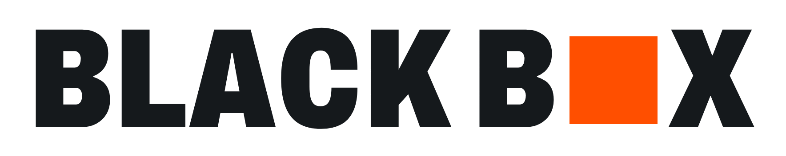

**A crash investigator for AI agents.** When a production AI agent misbehaves, Black Box's own team of agents reconstructs what happened, gathers evidence across your data through Zetaris, argues about the cause, and proposes a signed guardrail that a human approves. Then it replays the same bad request and proves the guardrail blocks it.

Open Agent Hackathon 2026 · Track 02: The Agent That Can Explain Why.

> Work in progress (build window 22–27 Oct 2026).

## Setup

Requirements: Node 22+, Docker (for the local Zetaris platform), and Meterless Nightshift running locally.

```bash
npm install
npm run setup          # vendors the Meterless World Model and H-MEM engines into vendor/
cp .env.example .env   # then fill in the Zetaris and Nightshift values
npm test
npm run dev            # API on http://127.0.0.1:8799
npm run dev:web        # UI on http://127.0.0.1:5178
```

## How the sponsor tech is used

| Sponsor | Role in Black Box |
|---|---|
| Zetaris | Every evidence query runs through the Zetaris REST API across the incident's data sources |
| Meterless | World Model: the incident's event-sourced timeline and replay. H-MEM: memory of past findings with provenance. Nightshift: the primary AI provider |
| NVIDIA Nemotron | Powers the investigating agents through Nightshift; its thinking budget rises when a claim is refuted |
| Cursor | The development environment for the whole build (see "How Cursor was used") |

## How Cursor was used

To be completed during the build, with screenshots.

## Pre-existing components

See [docs/pre-existing.md](docs/pre-existing.md).

## License

Apache-2.0 (the project started from the Apache-2.0 Meterless agentathon starter).
