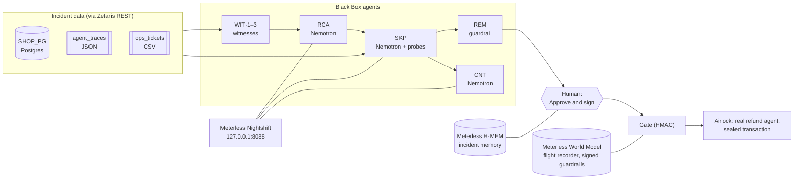

**A crash investigator for AI agents.** When a production AI agent misbehaves, Black Box's own team of agents reconstructs what happened, gathers evidence across your data through Zetaris, argues about the cause, and proposes a guardrail that a human signs. Then it replays the same bad requests and proves the guardrail stops them.

Open Agent Hackathon 2026 · **Track 02: The Agent That Can Explain Why.**

## Who it is for

The on-call engineer or ops lead who gets paged because an AI agent did something expensive. Today they read logs, guess, and patch a prompt. Black Box gives them an investigation they can audit: every claim has the query behind it, a Skeptic has tried to knock it down, and the fix is a signed rule, proven against the real failure before anyone trusts it.

## The incident in this repo

A real (small) refund agent runs on NVIDIA Nemotron through Meterless Nightshift. Its prompt still says "Refunds are allowed within 30 days of delivery", but on 18 Oct finance changed the policy to 14 days. On 21 Oct it processes 132 refund requests and **pays 40 refunds, 69,422 EGP, outside the live policy**. Support also files a ticket guessing that the payments provider returned duplicate IDs: a false lead.

The data is synthetic and seeded (`scenario/generate.ts`, seed 417), so the story is the same on every machine. The agent's decisions are real model calls.

## What happens when you click Investigate

1. **Flight recorder.** All 137 incident events (policy changes, the agent's decisions, the tickets) are written into the Meterless **World Model** engine and replayed from its event log. The engine's point-in-time fold answers "which policy was live at 10:00 on 21 Oct?" (v2, 14 days), and the 40 out-of-policy payouts show red.
2. **Witnesses** (WIT·1–3) query Postgres, the agent's JSON traces and the tickets CSV **through Zetaris** and file evidence tags on a grid (A1, A2, B1, B2, C1). WIT·3 files the duplicate-ID ticket as an unjudged hypothesis.
3. **Root-Cause** (RCA, Nemotron) reads the evidence and names the root cause and two findings, each citing the cells that prove it.
4. **Skeptic** (SKP, Nemotron) re-runs every cited Zetaris query itself (a claim whose rows do not reproduce is struck with no model call), runs its own cross-source probes (S1: the ticket against the payments table, 132 payments with 132 distinct refs; S2: 120 refunds for 120 distinct requests), and gives a verdict per claim. It strikes the false lead; three claims survive. Each strike makes the next round think harder.
5. **Counterpart** (CNT, Nemotron) is a customer-success VP who cross-examines the surviving claims. RCA must answer from the ledger; an answer that cites nothing marks the claim **weak**. In the recorded run, RCA could not explain *why* the prompt was never updated, and said so: that claim is marked weak.
6. **Remediator** (REM) compiles the surviving root cause into a guardrail contract: `issue_refund` pays only within `max_return_days` of the live policy, read from `policy_versions` when the gate checks.
7. **A human clicks "Approve and sign".** The contract is HMAC-signed and recorded as a World Model event. The gate refuses anything unsigned, or changed by a single character.
8. **The Airlock** replays the 40 bad requests through the real refund agent with the signed guardrail in front of the payout tool. The agent still decides "approve" 40 times. **The guardrail pays 0.** It runs in one transaction that is always rolled back, so the incident data never changes.
9. **Memory.** The signed finding is stored in the Meterless **H-MEM** engine with its provenance (ledger rows, cells, the Zetaris queries). The next investigation opens with "Remembered from BB-0417".

## The agents

| Callsign | Role | Model | What it produces | Who checks it |
|---|---|---|---|---|
| WIT·1, WIT·2, WIT·3 | Witnesses, one per data source | none: vetted Zetaris queries and template reports | evidence tags A1–C1 | SKP re-runs every query |
| RCA | Root-Cause investigator | Nemotron 3.5 Lightning | root cause + findings, citing cells | SKP, then CNT |
| SKP | Skeptic | Nemotron, plus its own probes | strike / survive verdicts, probe evidence S1–S2 | `demo:check` asserts the outcome |
| CNT | Counterpart (VP Customer Success) | Nemotron | questions aimed at ledger rows | uncited answers mark claims weak |
| REM | Remediator | none: a guardrail has to be exact | the guardrail contract | a human signs it; the Airlock proves it |

Witnesses and REM deliberately use no model: evidence and guardrails should be exact. Nemotron does the reasoning: naming the cause, judging it, cross-examining it.

## Architecture



- `server/` (TypeScript, Hono): agents (`server/agents/`), the gate and Airlock (`server/gate/`), the Zetaris client (`server/data/zetaris.ts`), the Nightshift provider (`server/ai/provider.ts`), the engines (`server/engines/`).
- `web/` (Vite, React): the Investigation Room. Events stream over SSE and every panel is a view of that stream.
- `scenario/`: the seeded incident, the loader that registers it in Zetaris, and the culprit run.

## How the sponsor technology is used

The full explanation, with the test behind each engine, is in [docs/sponsor-tech.md](docs/sponsor-tech.md).

**Zetaris (data).** Every piece of evidence is a SQL query sent to the local Zetaris platform over REST (`POST /api/v1.0/sql-editor/sqls/run`). The incident spans three sources registered in Zetaris: a Postgres datasource (`SHOP_PG`: orders, refunds, payments, policy versions), and two Lightning filestore tables (`BB_FILES.agent_traces` as JSON, `BB_FILES.ops_tickets` as CSV). Several queries join across sources in one statement, for example B2 (agent traces × Postgres refunds × the live policy) and S1 (tickets CSV × payments). The flight recorder reads all three through Zetaris too.

**Meterless (build and power).**
- **World Model engine:** the flight recorder is an event-sourced log; the "policy at the moment of the incident" comes from the engine's point-in-time fold (`server/engines/world-model.ts`). Signed guardrails are World Model events persisted per namespace (`server/gate/store.ts`).
- **H-MEM engine:** signed findings are remembered with provenance and recalled at the start of the next investigation (`server/engines/hmem.ts`).
- **Nightshift / Meterless Runtime:** the OpenAI-compatible provider at `127.0.0.1:8088/v1`, implemented from the official Power Prompt (`server/ai/provider.ts`). Each reply's compute receipt (routed model, cache status, cost) is kept and shown; replies served from Nightshift's exact cache are labelled "cache".

**NVIDIA Nemotron (reasoning).** Nemotron 3.5 Lightning (`nvidia/nemotron-3.5-lightning-30b-a3b`, through Nightshift) runs the refund agent, RCA, the Skeptic and the Counterpart. Nemotron always reasons before it answers, so `max_tokens` is the real thinking budget. Black Box makes that visible: a call that runs out climbs a ladder (2,048 → 4,096 → 8,192 tokens), and every refutation makes the next Skeptic round start higher. The meter says why it rose.

## Run it

Requirements: Node 22+. Everything else is optional.

```bash
npm install
npm run setup          # vendors the Meterless World Model and H-MEM engines into vendor/
npm test
npm run demo:check -- --replay
```

**Without the sponsor services (judges start here).** If Zetaris, Nightshift or the shop database is not reachable, the app serves the recordings of the last live run and says so in a banner. Every query result, model reply and verdict in them came from a real run; signing and the gate still run on your machine.

```bash
npm run dev            # API on http://127.0.0.1:8799 (replays automatically when services are down)
npm run dev:web        # UI on http://localhost:5178
```

Open the UI, click **Investigate**, then **Cross-examine the finding**, **Approve and sign**, and **Replay the incident through the Airlock**. `npm run dev:replay` forces replay mode even when services are up.

**Fully live.**
1. Run the local Zetaris platform with Docker (Zetaris "Install Locally" guide) and create an API key in its UI.
2. Run Meterless Nightshift (M1–M4 edition) with your NVIDIA key in Setup → Providers and Nemotron 3.5 Lightning on lane 1.
3. `cp .env.example .env` and fill in `ZETARIS_API_KEY` and `SHOP_DB_PASSWORD`. The Nightshift token is read from its runtime-token file.
4. Start the shop database, load the incident into Zetaris, and run the culprit:
   ```bash
   docker compose --env-file .env up -d
   npm run reset          # rebuilds the shop DB, registers the sources in Zetaris (keeps H-MEM memory; add -- --forget to clear it)
   npm run culprit        # the refund agent pays the 40 bad refunds, for real
   npm run demo:check     # live: investigation + Airlock, asserts the outcome
   ```

A live investigation takes 3–7 minutes (several Nemotron reasoning calls of 20–80 s each). Every live run overwrites the recordings in `data/recordings/`.

## Run it without the UI (sample inputs and real outputs)

`npm run agent -- --input <file>` runs one input through the same agents and writes `<file>.output.json` and `<file>.trace.jsonl` (every event, every Zetaris evidence query and every model call with the model that answered). `POST /api/run` takes the same JSON. Live when the services are up (the run is recorded), otherwise from the recording; the output's `mode` says which.

| Input (`examples/`) | What it asks | Real output (run on 24 Oct) |
|---|---|---|
| `example_1.investigate.json` | Why did the refund agent pay refunds it should not have? | root cause + 3 surviving claims, the false lead struck, a proposed guardrail (from the recorded live run) |
| `example_2.challenge.json` | "The payments provider returned duplicate payment IDs, so customers were refunded twice." | **struck** by the Skeptic: S1 and S2 show 0 duplicate payment IDs and 0 double refunds (live) |
| `example_3.challenge.json` | "The agent was still prompted with a 30-day window after the policy changed to 14 days." | **survives**: B1 shows the 30-day prompt, B2 the reasons it gave (live) |
| `example_4.airlock.json` | Sign REM's guardrail and replay the 40 bad requests | 40 attempted, 40 blocked, **0 payouts executed** (live, through Nightshift) |

A `challenge` input puts your own hypothesis in front of the Skeptic, with every witness's evidence and its own probes. In the `airlock` input, `approver` stands in for the human who clicks "Approve and sign" in the UI.

## Reproducible execution

- **Recordings** (`data/recordings/`): every Zetaris answer and every Nightshift reply of the last live run, failures included. Replay takes the same path the live run took, including the budget climbs.
- **`npm run demo:check`** asserts the outcome end to end: the Skeptic's re-runs reproduced, the false lead is struck, the root cause and at least 3 claims survive, REM proposes a guardrail, and the Airlock pays 0 of 40.
- **Tests** (`npm test`): providers, engines, agents, the contract gate (including a one-character tamper), and the Airlock gate hook.

## What is honest about this demo

- The refund agent's 132 decisions were made live by Nemotron on 22 Oct. Later runs of the same prompts are answered from Nightshift's exact cache, and Black Box labels them as cached.
- Witnesses and REM use no model, by design. The template reports state only what the rows say.
- Nightshift ends calls that reason for too long, so every agent call streams. Streamed receipts carry no token counts, so the meter shows the budget given, not the tokens used.
- The live window is read from the policy table when the gate checks, so the guardrail cannot go stale when finance changes the policy again.

## How it was built

Built with Claude Code during the build window (22–27 Oct 2026). Cursor became optional on 22 Oct (HackOS announcement), so Cursor was not used.

## Pre-existing components

See [docs/pre-existing.md](docs/pre-existing.md).

## License

Apache-2.0 (the project started from the Apache-2.0 Meterless agentathon starter). See [LICENSE](LICENSE).
